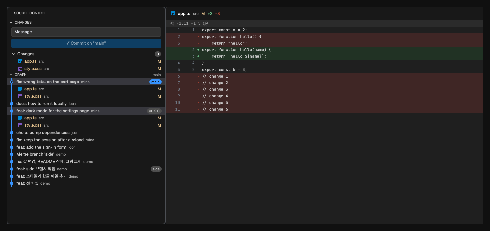

# Ray Changes

Herdr's Changes panel in the look of VS Code's Source Control: the commit
box and changed files on top, the commit graph below. Click a commit for its
files, click a file for its diff in a large dialog.

## What you see

- A side panel in VS Code's Dark Modern colors whatever your app theme is:
  sidebar `#181818`, borders `#2B2B2B`, text `#CCCCCC`, 13px. A
  "SOURCE CONTROL" line (35px, 11px text), then two sections, each under a
  22px title with a chevron: **CHANGES** and **GRAPH** (the branch name at
  its right).
- CHANGES: a message box (28px, `#313131`), a full-width blue button
  (`#0078D4`, "✓ Commit on "main"", dimmed until there is a message), a
  "Changes" line with the number of files in a round badge, then the files
  in 22px rows: Material Icon Theme icon, name, its folder dimmed, and the
  status letter at the right in VS Code's colors (`M` `#E2C08D`, `U`
  untracked `#73C991`, `A` `#81B88B`, `D` `#C74E39` with the name struck
  through, `!` conflict `#E4676B`).
- GRAPH: the last 80 commits in 22px rows on one blue (`#3794FF`) line: a
  dot (a ring for HEAD), the subject (bold for HEAD), the author dimmed,
  and up to two branch or tag names as pills (the current branch in blue).
  An opened commit is marked `#37373D` and lists its files under it, as in
  CHANGES.
- The diff dialog (86% of the window each way, `#1F1F1F`): a 40px bar with
  the file's icon, name, folder, status letter, `+added −removed`, then the
  commit (`abc1234 · subject`) or "Working Tree" and a ✕. Below it the
  unified diff in your terminal font at 12px: old and new line numbers,
  a `+`/`-` column, added lines on green (`#2EA04326`), removed on red
  (`#F8514926`), hunk headers on `#2B2B2B`.

## How it behaves

- It follows the focused pane's folder (and machine), rereads every 10
  seconds and when the folder changes, and writes nothing under `.git`
  while reading.
- A section's title folds it. With both open, the boundary between CHANGES
  and GRAPH drags (CHANGES is at least 110px).
- Click a commit to list its files, again to fold it. A merge lists what it
  brought in (against its first parent); the first commit lists every file.
  Opened commits stay open while you move between panes of the same
  repository.
- Click a file, in CHANGES or under a commit: its diff opens in the dialog.
  Escape or ✕ closes it. An untracked file shows as all added.
- Enter in the message box, or the button, runs `git add -A` then
  `git commit -m <message>`: everything is committed, there is no staging.
- A press inside the panel gives it the accent border the focused terminal
  pane has, until a press elsewhere.

## Built from

- `mods/ray-changes/main.js`: one mod in two shapes, the panel and (opened
  by itself with `props.view: "diff"`) the dialog. `look.js` and
  `icon-map.js` are copies of Ray Files' (colors, which icon a name gets);
  `focus-ring.js` is the focus border.
- **The icons are Ray Files' own**: rows draw `mods/ray-files/icons/<name>.svg`,
  so add `herdr.dev/mods/speardragon/ray-files` too (or copy its `icons/`
  folder there). Without it the rows have no icons.
- `mod.json`: `place: none`, `cloned_from: changes`. A layout shows it with
  a block whose `content.mod` is `ray-changes`.
- Calls: `spaces()`, `panes()`, `focused()`, `exec` (`git rev-parse`,
  `status`, `branch`, `log`, `diff`, `diff-tree`, `show`, and for a commit
  `add -A` and `commit`), `readTextFile`, `watchFolder`, `settings()`,
  `openOverlay` (`kind: "dialog"`, 0.86 × 0.86), `closeOverlay`, `props()`;
  gpui-base's `Input`, `v_virtual_list`, `Scrollbar`, `v_resizable`.

## Watch out

- The graph is one line: it doesn't draw branches splitting and merging.
- The diff is unified, not side by side, and has no syntax colors. The
  first 5,000 lines are shown; a commit lists at most 500 files; the panel
  lists the first 1,000 changed files.
- File names are read with `-z` and `--no-renames`: a rename shows as a
  delete and an add.
- A mod can't import from another mod's folder (the check refuses it), which
  is why `look.js` and `icon-map.js` are copied. Images may come from
  another mod's folder.
- A list needs the absolute-inset pattern (`list()` in `main.js`) to scroll
  inside its section; the two `v_resizable` panes need `overflow_hidden`.
- A clone is never updated with Herdr's `changes` mod.

## Done when

- In a repository with changes, CHANGES lists them with icons and letters,
  and GRAPH shows the commits with HEAD as a ring and the branch pill.
- Clicking a commit lists its files; clicking one opens the diff dialog with
  red and green lines and line numbers; Escape closes it and the commit is
  still open.
- Clicking a changed file opens "Working Tree" in the dialog.
- Dragging the boundary under CHANGES resizes the two sections.
