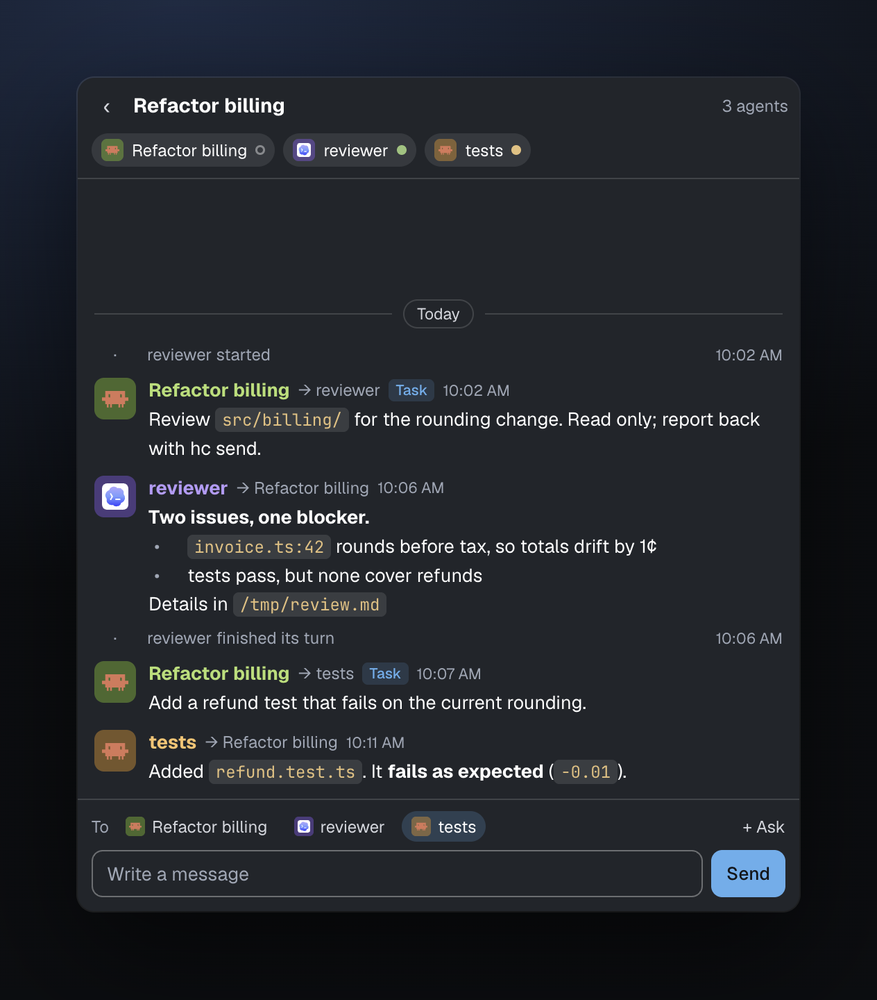

# Ray Chat

What your agents say to each other, as a chat app shows it. When an agent starts others with `hc run`, the reports and tasks they pass with `hc send` are collected into one conversation per family, with Markdown drawn properly; a four-step builder has one agent ask, review, second-guess or hand work to another without you writing out how.

## What you see

- A window (520×680, `ctrl-alt-c`) or a side panel, on your theme's background.
- **List:** a row a conversation, newest first: the top agent's program logo on a color of its own (34px, rounded 22%), its name (bold when unread), "N agents", a state dot (working amber spinner color, blocked red, done blue, idle ring), the last message on one line, the time ("2:03 PM" today, else "Yesterday" / "11/10"), and a red unread count.
- **Conversation:** a 40px header (‹ back, the name, "N agents"), chips of the agents in it (logo 16px, name, state dot; pressing one focuses that agent), then the messages oldest to newest with the newest at the bottom:
  - a day line ("Today") between days;
  - a message: logo 30px, the sender's name in its own color (lightened 38% toward white), "→ receiver", a "Task" tag on the first task, the time, and the text as Markdown: bold, `code` as a tinted chip, code blocks in a bordered box, lists, quotes with a bar, links;
  - lines for events: "x started", "x finished its turn", "x needs you", "x ended".
- **Box:** "To" chips of the live agents, an input and Send. The default receiver is whoever spoke last.
- **+ Ask:** a four-step builder with a stepper (1 Who asks · 2 Whom it asks · 3 What for · 4 Write), a robot drawing and the step's question, a big Next button (grey until something is chosen), Send on the last step.

## How it behaves

- A row or a chip opens or focuses; the wheel moves through older messages a message at a time and stops when the first one is at the top; "Newest ↓" goes back.
- Hovering a message shows **Copy** (the text isn't selectable: it is drawn, not a text view).
- Opening a conversation marks it read; the unread total is shared as `ray.chat.unread` (a tab bar can badge it).
- **Builder:** step 1 lists the running agents grouped under their spaces (machine tabs when several machines, the space in view open, others folded; the focused agent has an accent bar and a "Current" tag). Step 2: start a new agent (installed programs from `knownAgents()`, `hc templates`) or an agent already running (foldable list). Step 3: Ask, Get a review, Get a second opinion, Delegate a task. Step 4: a one-line summary (each part jumps back) and the text. Choosing marks; Next or a step number moves on. The last request's target and kind are filled in next time.
- The text sent tells the asking agent how to start or reach the other (`hc run --bg --name …` or `hc send <address>`), what to give it, its limits (read-only for questions; for Delegate: what it may change), to report in Markdown, to wait with `hc wait`, and how to sum the answer up.

## Built from

- `mods/ray-chat/`: `main.js` (shapes by `props().view`: `"watch"` a hidden status-bar block that records; none: the panel; `"window"` list and conversation side by side), `watch.js` (recording), `scan.js` (reading messages), `store.js` (the log), `model.js`, `list.js`, `thread.js`, `ask.js` + `picker.js` (builder), `prompt.js` (the text sent), `markdown.js` + `rich.js` (Markdown), `names.js` (sidebar-style names), `parts.js`, `i18n/` (English and Korean).
- hc keeps no message history: a message is typed into the receiver as `<hc from="t7 review">…</hc>`. The watcher finds parent/child terminals (`terminals()`, `parent`), reads each receiver's session record — Claude Code: `~/.claude/sessions/<pid>.json` → `~/.claude/projects/**/<session>.jsonl`; Codex: the newest thread for the folder in `~/.codex/state_*.sqlite` (`sqlite3`) — with `grep`, and appends new items to `~/.config/herdr-app/ray-chat/log.json` (written with `writeTextFile` and an expected snapshot).
- Without a watcher block, an open panel or window records by itself (a module-level heartbeat tells).
- Calls: `terminals()`, `agents()`, `spaces()`, `panes()`, `focused()`, `knownAgents()`, `hc(["send", …])`, `hc(["templates"])`, `run("agent.focus")`, `openOverlay`, `closeOverlay`, `shared`/`setShared`, `exec` (`grep`, `find`, `sqlite3`, `pbcopy`).

## Watch out

- Only messages received by Claude Code or Codex agents show (others keep no readable record). Messages typed by a person carry no tag: the panel records what it sends itself.
- A message that arrives while Claude Code is busy is recorded as a `queue-operation`; a multi-line one is wrapped in `<pasted_content>`. Both must be read, and the same text can appear twice (deduplicated within 10 minutes).
- Never notify (`cx.notify()`) inside `render`; parse Markdown once a message (QuickJS has no JIT).
- English by default; Korean when `ray.locale` is `ko` (the Ray Theme's language picker).

## Done when

- Start a child with `hc run --bg --name t claude "…reply with hc send $HC_TERMINAL_ID 'hi **there**'"`: within seconds the conversation lists both agents, the task, and the reply with "there" in bold.
- The builder's Send makes the chosen agent start or message the other, and the exchange shows up in the same conversation.
- Copy puts a message on the clipboard; the unread count clears when the conversation is opened.
