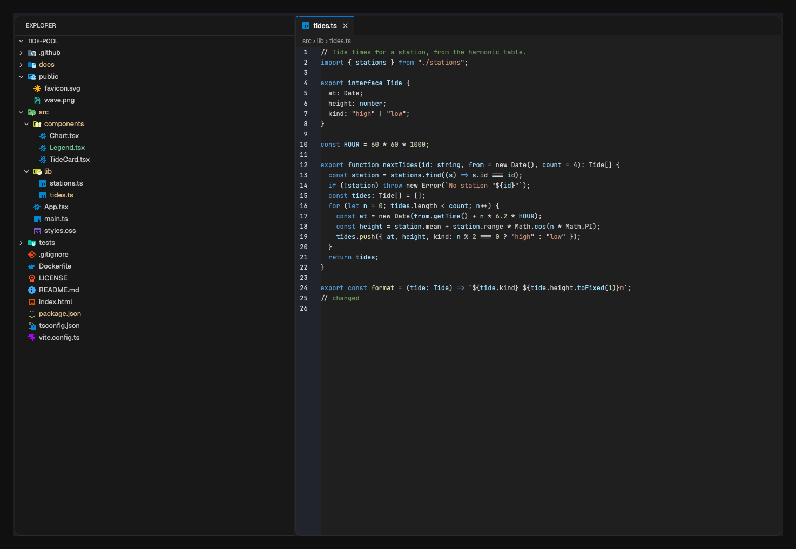

# Ray Files

Herdr's file panel in VS Code's look: the explorer tree with Material Icon
Theme icons, previews colored like the Dark Modern theme, and pictures shown
as pictures.

## What you see

- A side panel in VS Code's Dark Modern colors whatever your app theme is:
  sidebar `#181818`, editor `#1F1F1F`, borders `#2B2B2B`, text `#CCCCCC`.
- The tree: an "EXPLORER" line (35px, 11px text), then the folder's name in
  bold capitals with a chevron, then 22px rows indented 10px a level. A row
  is a chevron (folders only), a 16px full-color icon and the name. Hover is
  `#2A2D2E`; the file you last opened stays marked `#37373D`. Corners are
  square.
- Icons are Material Icon Theme's: by whole file name (`package.json`,
  `Dockerfile`), else by the longest known ending (`d.ts` before `ts`),
  else a plain file; folders by name (`src`, `docs`, `public`…) with a
  separate open icon.
- Git marks at the row's right, in VS Code's letters and colors, with the
  name tinted the same: `M` modified `#E2C08D`, `U` untracked `#73C991`,
  `A` added `#81B88B`, `D` deleted `#C74E39`, `!` conflict `#E4676B`. A
  folder holding a change gets a `•` and the modified color.
- An open file replaces the tree: a tab (35px: icon, name in white, ✕, an
  accent `#0078D4` line on top) and, for a file inside a folder, its path
  as `a › b › c`.
  - Code: the app's read-only editor (line numbers, folding, selectable)
    with Dark+ token colors: keyword `#569CD6`, string `#CE9178`, comment
    `#6A9955`, function `#DCDCAA`, type `#4EC9B0`, number `#B5CEA8`,
    constant `#4FC1FF`, variable `#9CDCFE`.
  - Markdown (`md`, `mdx`, `markdown`): its source, numbered and wrapped,
    colored as Dark+ colors it: headings and bold `#569CD6`, italic
    `#C586C0`, inline code and link text `#CE9178`, list markers `#6796E6`,
    quote markers `#6A9955`.
  - Pictures (`png jpg jpeg gif webp bmp ico tiff tif avif svg`): the
    picture, centered, scaled down to fit, never up.

## How it behaves

- Everything else is Herdr's own `files` mod, which this is a clone of: it
  follows the focused pane's folder, loads folders as you open them (500
  entries a folder, 5,000 in all), watches the folder, rereads every 10
  seconds, hides `.git`, remembers each folder's open folders and file,
  and works on other machines.
- Click a folder to open or close it, a file to preview it, the tab's ✕ to
  go back to the tree.
- A picture is copied to `~/.config/herdr-app/data/ray-files/preview-<time>.<ext>`
  when opened, because the app draws images only from its own folder. The
  copy before it is removed first, so there is one at a time.

## Built from

- `mods/ray-files/main.js` (the tree, loading, previews), `look.js` (the
  colors, which icon a name gets), `mdview.js` (Markdown source coloring),
  `icon-map.js` (generated from Material Icon Theme 5.40.0's
  `dist/material-icons.json`: file endings, file names and folder names,
  lowercased), `icons/` (the SVGs those names use, with the theme's MIT
  `LICENSE`), two chevron SVGs.
- `mod.json`: `place: none`, `cloned_from: files`. A layout shows it with a
  block whose `content.mod` is `ray-files`.
- Colors come from VS Code's `dark_modern.json`, `dark_plus.json` and
  `dark_vs.json` (`extensions/theme-defaults/themes/`) and its default list
  and git decoration colors.
- Calls: `spaces()`, `panes()`, `focused()`, `exec` (`sh` or PowerShell to
  list a folder, `git status`, `sh` to copy a picture), `readTextFile`,
  `watchFolder`, `settings()`, `window()`; gpui-kit's `image()` for icons
  and pictures, gpui-base's `Editor`/`EditorState` for code.

## Watch out

- The editor has one keyword color, so `if`/`return`/`import` are the same
  blue as `const`, not VS Code's purple. Its line numbers and their strip
  follow the app's theme; a mod can't set them.
- The editor gives Markdown no colors, so Markdown is drawn line by line:
  its text can't be selected or copied, code inside a fence is one color,
  and only the first 1,500 lines are drawn.
- Pictures on another machine aren't shown, and the copy step uses `sh`, so
  not on Windows either.
- A clone is never updated with Herdr's `files` mod; later fixes there have
  to be brought over by hand.
- The icons add about 4.5 MB (1,133 SVGs).

## Done when

- The tree shows a TypeScript icon on a `.ts` file, a special folder icon
  on `src`, and a changed file's name in `#E2C08D` with an `M`.
- Opening a `.ts` file shows the tab and blue keywords on `#1F1F1F`;
  opening a `.md` file shows blue headings; opening a `.png` shows the
  picture and leaves exactly one file in `data/ray-files/`.
- The ✕ returns to the tree with that file's row marked.
