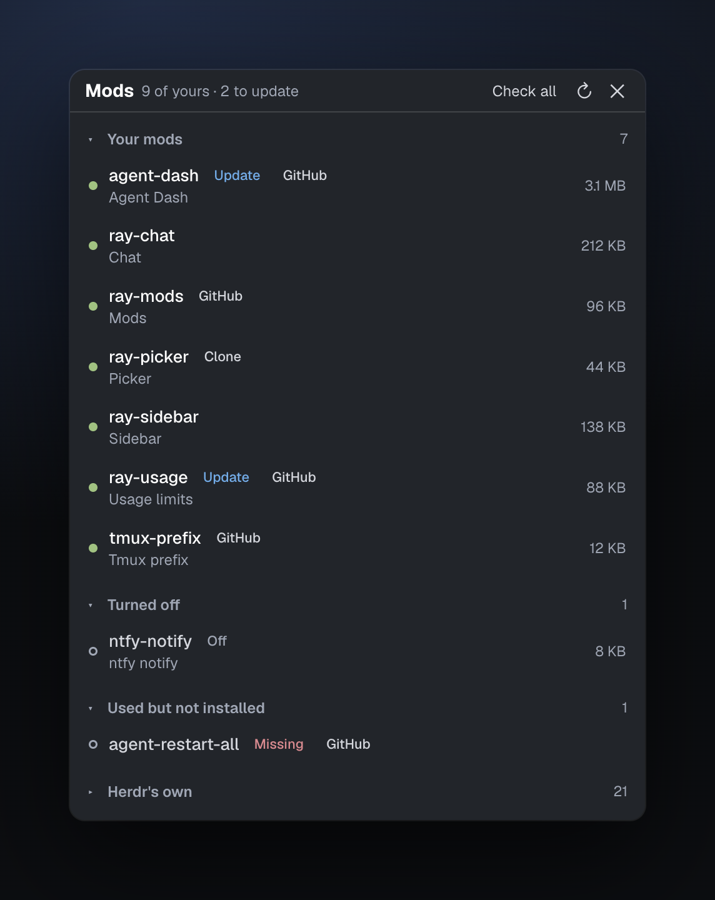

# Ray Mods

The mods installed in your Herdr, in one window: what each is, where your layout and keys use it, where it comes from; update it from its GitHub repository, turn it off and on, or remove it — with nothing deleted for good.

## What you see

- A window (460×660, `ctrl-alt-m`) or a side panel. Header: "Mods", "N of yours · N to update", Check all, ↻, ✕ (in a window).
- Sections: Your mods, Turned off, Used but not installed, Herdr's own (folded). A row: a dot (green: used by the layout or keys; ring: unused or off), the name, badges (Update, Changed here, Off, Missing, Clone, GitHub), the title, the size.
- A mod: title, kind, size and files, last change, the layout blocks and keys that use it, and a Source box (repository and folder, installed commit, latest commit with date and message), or a field to link one (`owner/repo`). Buttons: Check, Update (or Install), Turn off / Turn on, Remove, Folder, Unlink.

## How it behaves

- **Update:** downloads the newest commit of the mod's folder, replaces the folder (the old one goes to `.install-spare/old-…`), runs `herdr-app check`, and puts the old one back if the new one doesn't load. Over files changed since install, or of an unknown version, it asks for a second press.
- **Turn off:** Herdr has no switch for a mod, so this hides the mod's blocks in the shown layout (`hidden: true`) and takes its bindings out of `keys.json`, keeping both; Turn on puts them back (keys taken meanwhile stay as they are). Asks for a second press.
- **Remove:** moves the folder to `.install-spare/trash-…` (only when no layout block uses it). Asks for a second press.
- Linked mods are checked on open and every 6 hours; the number with an update is shared as `ray.mods.updates`.
- Herdr's own mods are read-only here; the panel can't turn itself off.

## Built from

- `mods/ray-mods/`: `main.js`, `list.js`, `detail.js`, `inventory.js` (folders, `installed.json`, the shown layout, `keys.json`), `actions.js`, `registry.js` (`~/.config/herdr-app/ray-mods/registry.json`: sources and what turning off put away), `ops.sh` (inventory, fingerprint, download, install, restore, trash), `lib/github.js`, `i18n/`.
- GitHub through `gh` (`gh api repos/<repo>/commits?path=…`, `…/tarball/<sha>`), trying a logged-in account named like the repo's owner first.

## Watch out

- A mod folder must appear whole (the app reads `mod.json` the moment the folder shows up): build it beside `mods/` on the same disk, then `mv`.
- "Off" touches only the shown layout; a mod another mod opens in code still opens.
- Needs `gh` logged in for private repositories; macOS and Linux `stat` are both handled.

## Done when

- The list matches `ls ~/.config/herdr-app/mods`, with Herdr's own folded.
- Linking `owner/repo` that has `mods/<name>/` shows its latest commit; Update replaces the folder and keeps the old one under `.install-spare/`.
- Turn off hides the mod's block and removes its keys; Turn on restores both.
