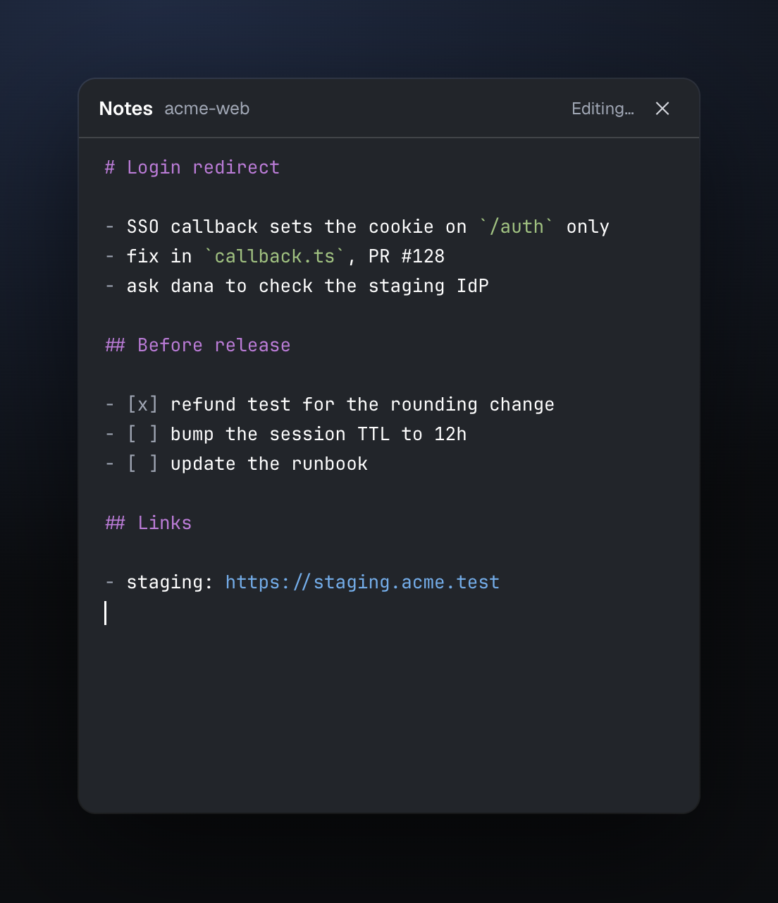

# Ray Notes

One Markdown note per space: switch to a project and your notes for it are
there again, typed in the side panel or its own window, kept on disk as a
plain `.md` file next to nothing else.

## What you see

- A window (440×560, `ctrl-alt-n`) or a side panel, on your theme's
  background.
- Header (42px): "Notes", the active space's name (dimmed, truncated), and
  a status word on the right — "Editing…" while something's unsaved, "Not
  saved" (in the blocked color, hover for the error) if the last save
  failed, otherwise blank — and, only in a window, a ✕.
- When the shown space's note is empty and nothing's unsaved, a hint line
  sits above the box: "Click below and write anything for this space. It's
  saved as Markdown."
- The body is a plain Markdown editor (no line numbers, no folding,
  soft-wrapped, 13px, your terminal's font) filling the rest of the window;
  without an active space it just says "Open a space to take notes for it."

## How it behaves

- Typing marks the note unsaved ("Editing…"); a timer ticks every second
  and writes to disk whenever something's unsaved — in practice, within a
  second of typing something, saved or not.
- Every 3 seconds, if nothing's unsaved and no space switch is in flight,
  the file is read again from disk — so a panel and a window open on the
  same note pick up what the other just saved.
- Switching the active space saves the old note first, then loads the new
  space's file (starting empty if it has none yet).
- If the file changed on disk since it was last read here — another window
  saved first — the next save goes through anyway: what's typed here
  overwrites it.
- The mod saves once more when it closes (its pane, tab or window going
  away, or the app quitting).
- A press inside the panel gives it the accent border the focused terminal pane has, until a press elsewhere (`focus-ring.js`).

## Built from

- `mods/ray-notes/main.js` (the whole mod), `i18n/` (English and Korean).
- `mod.json`: `place: none` (docks only where a layout or mod puts it),
  `overlay` kind `window` (440×560); `keys.json` binds `ctrl-alt-n` to
  `mod.open:ray-notes`.
- A space's note lives at `~/.config/herdr-app/ray-notes/<name>.md`, where
  `<name>` is its folder (its id if it has none), stripped of leading
  slashes, with every run of `/ \ : * ? " < > |` turned into one `_`, and
  prefixed `<machine>_` for a space on another computer. A derived name
  that comes out empty (a folder of exactly `/`) falls back to `home.md`.
- Calls: `spaces()`, `theme()`, `settings()`, `appHome()`, `readTextFile` /
  `writeTextFile` (given the last-known disk snapshot, so a lost write race
  is noticed rather than silently overwriting), `props()`, `closeOverlay()`;
  `fs/promises`' `mkdir` to create the folder on first save; gpui-base's
  `Editor`/`EditorState` for the text box.

## Watch out

- The mod's own header comment says typing "saves after a second's pause,"
  but the save timer is a flat every-second tick that writes whenever
  something's unsaved — it doesn't actually wait for you to stop typing.
- No file lock: two windows on the same note, both edited at once, each
  save over the other on their own timer; whichever saves last keeps its
  text ("typed here wins" only resolves a disk change made *between* reads
  and the next save, not two live editors).
- A note needs an active space; nothing is shown or saved without one.

## Done when

- Typing a line and waiting about a second, then checking
  `~/.config/herdr-app/ray-notes/`, shows a new or updated `.md` file
  matching the space's folder.
- Opening the same space's note in both the panel and a `ctrl-alt-n`
  window, typing in one, and waiting a few seconds shows the same text
  appear in the other.
- Switching to a different space shows that space's own note (or the
  empty-state hint), not the one before it.
