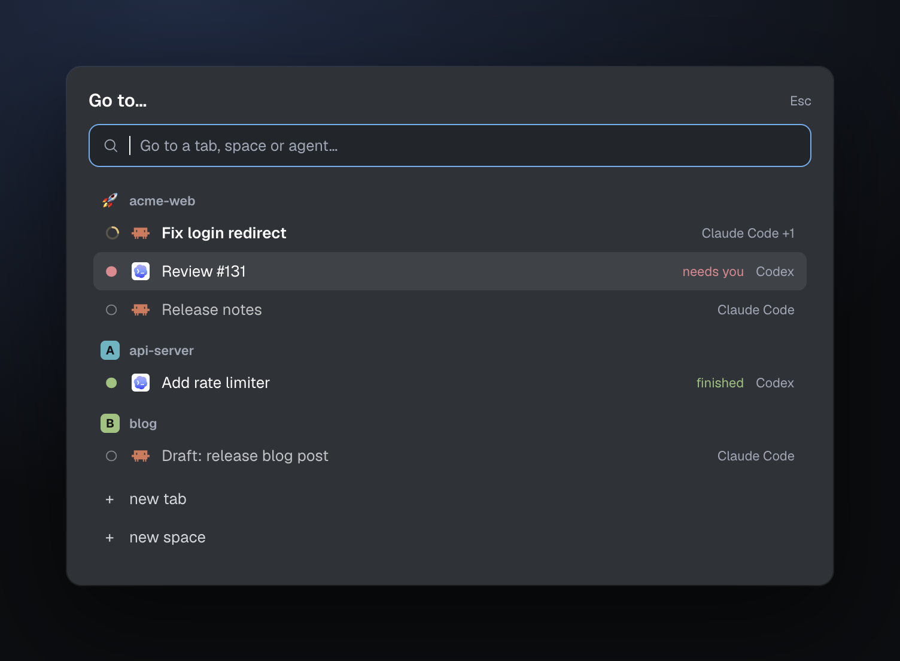

# Ray Picker

A clone of Herdr's own picker, grown to match the sidebar: a "Go to…" popup with the same space logos and colors Ray Sidebar draws, plus each tab's agent icon, idle names dimmed the same way. Opens with `cmd-p`.

## What you see

- A popup, 640px wide, docked near the top (40px down), at most 80% of the window tall; the list inside is capped at 320px.
- A header: "Go to…" and an "Esc" hint.
- A search field (36px, accent border) with a magnifying-glass icon and the placeholder "Go to a tab, space or agent…".
- A scrolling list: a group per space with a running agent — its logo and name (dim, 18px logo) — then one row per tab (32px): a small status glyph (a spinner working, a filled or hollow dot otherwise, colored by status), the tab's agent's program icon, the tab's name (bold where you are now, dimmed if idle elsewhere), "needs you" in red or "finished" at the right for a blocked or done tab, and the agent's program name(s) with a "+N" if it has a team of sub-agents.
- Spaces with no agent running collapse under an "earlier: N quiet spaces ▾" row; click it to show them.
- At the end: "+ new tab", "+ new space", and "+ new space on {machine}" for each connected machine.

## How it behaves

- Typing filters by space, tab and agent program name; ↑/↓ move the highlight (wrapping around); Enter or a click goes to the row, or runs the new-tab/new-space row; Esc closes.
- Ctrl+D on a highlighted tab closes that tab and the popup together.
- It opens already highlighting the tab you're on, and scrolls only as much as it needs to keep the highlight in view.

## Built from

- `mods/ray-picker/main.js`, byte-identical whether it's the standalone mod or the copy ray-sidebar bundles; `mod.json`'s `cloned_from` names it a clone of Herdr's shipped `picker` (version `0.1.14`), with its own popup settings (`kind: "popup"`, `at: "top"`, `offset: 40`, `width: 640`, `height: 0.8`).
- Draws a space's logo the same way Ray Sidebar's `logo.js` does — read straight from shared `space.logos` and `space.colors`, the same six-hue fallback palette and letter-on-color rule — independently reimplemented here since mods can't import across folders. An agent's program icon and the idle-dim rule (the theme's foreground color at reduced opacity when it's a plain hex, else its muted color) are drawn the same way too.
- Calls: `agents()`, `spaces()`, `terminals()`, `theme()`, `settings()`, `props()`, `shared`/`setShared`, `closeOverlay`, `run()` (`tab.select`, `tab.new`, `tab.close`, `space.new`), `hc(["machine", "ls", "--json"])` for the connected-machines rows.
- `keys.json`: the global `cmd-p` → `mod.open:ray-picker`.
- Icons come from Herdr's own shipped `workspace-chrome` mod too (`mods/workspace-chrome/spinner.svg`, `search.svg`), the same dependency Ray Sidebar has.

## Watch out

- Clones (`cloned_from`) are never updated automatically, so an update to Herdr's own `picker` won't reach this copy.
- It has no `i18n`: it stays in English regardless of the shared language, unlike the rest of the Ray family.
- Without Ray Sidebar installed, nothing ever writes `space.logos`: every space falls back to its first letter on a color. `space.colors` itself is still assigned and written by this mod's own copy of the six-hue algorithm, so the colors match what Ray Sidebar would pick, even without it installed. A space literally named `~` is drawn in the theme's dim gray here, not the teal Ray Sidebar's own fallback gives it.
- The "earlier" spaces only expand on an explicit click (or while filtering); otherwise only spaces with a live agent are listed.

## Done when

- `cmd-p` opens a 640px popup near the top of the window.
- Typing narrows the list to matching tabs, spaces and agent names live.
- A space's custom logo and color (set in Ray Sidebar) shows up here too.
- A blocked tab's space is sorted above quiet ones and shows "needs you" in red.
