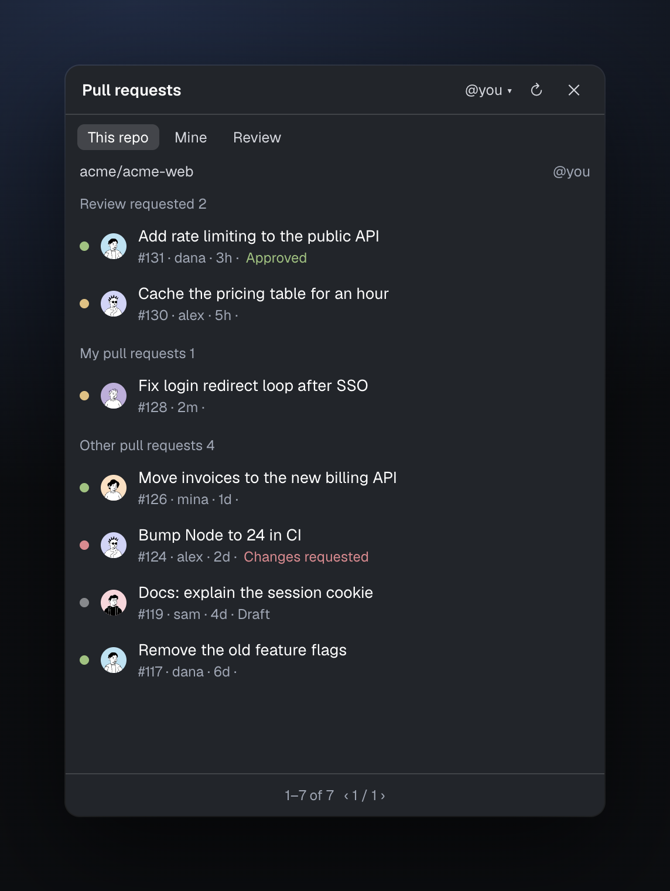

# Ray PRs

The pull requests you're part of, as a side panel or its own window: three
filters (this repo, mine, review requested), a check and review-decision dot
on every row, and a button that hands a PR's review comments straight to
whichever agent you're facing.

## What you see

- A window (460×700, `ctrl-alt-p`) or a side panel, on your theme's background.
- Header (42px): "Pull requests", the GitHub account being asked with a ▾
  (opens a picker), a ↻ refresh (amber/working while a read is in flight,
  else muted), and, only in a window, a ✕.
- Filters row: "This repo" (default), "My pull requests", "Review requested" —
  the active one sits on a raised background in bold.
- The account picker (when open): gh's own default account, each signed-in
  login, and "All accounts" once more than one login is signed in; a dot
  marks the one in use.
- **This repo:** a line naming `owner/repo` (click opens its Pull Requests
  page on GitHub) on every page, with "@you" once your login is known
  (tooltip: mine and review requests are counted for that login). The first
  page pins "Review requested" and "My pull requests" (up to 50 each) above
  "Other pull requests" (its own count); later pages are "Other pull
  requests" alone, 20 at a time.
- **My pull requests / Review requested:** one list across every repository
  the asked account(s) can see, newest updated first.
- A row: an 8px round dot for checks (blue/done once they pass, red/blocked
  on failure or error, amber/working while running, dim with none — hover
  for which), a 22px round avatar (the author's picture once downloaded,
  else their first letter on a gray disc, or "?" for a deleted account), the
  title (dimmed when draft), and a meta line — `#number` and the author
  inside one repo, else `repo #number`; how long ago it updated ("2h",
  "3d"); "Draft"; which account saw it, only when several are merged — with
  "Approved" (blue/done) or "Changes requested" (red/blocked) on the right
  once a review decision exists.
- Hovering a row shows "To agent", but only while a pane is focused with a
  running agent in it.
- A footer ("1–20 of 47", ‹ ›) once a list runs past one page.
- States you can land on: "Focus a terminal on this computer to see its
  repository's PRs.", "Loading…", "This folder isn't a GitHub repository.",
  "No open pull requests in this repository.", "gh isn't installed." (gh
  itself can't be run), the account-denied notice below, or gh's own error
  line.

## How it behaves

- Clicking a row opens the PR in the default browser.
- "To agent" sends the focused pane's agent (else whichever agent is
  focused) one line through `hc send`: "Check the review comments on `<url>`
  and address them." — the panel doesn't read or act on the comments itself.
- The filter is shared (`ray.prs.filter`), so a panel and a `ctrl-alt-p`
  window agree on which one is shown.
- Each list is read the first time it's shown, then again every 3 minutes or
  on ↻; switching back to an already-read page just shows what's cached.
- **This repo** tracks the focused terminal's folder (else the shown
  space's); only its `origin` remote is read, and only when it's a
  `github.com` URL (https, ssh, or a ssh host alias) — anything else reads
  as "not a GitHub repository." A folder's repo is remembered for 5 minutes.
- **Account to ask:** normally one account asks — the one picked in the
  header, or gh's own default. If it can't see the repository, the panel
  says so and offers "Choose an account" rather than trying another one
  itself. Only picking **All accounts** (shown once 2+ logins exist) makes
  it try accounts automatically: the login named like the repo's owner
  first, then the others, remembering whichever worked for next time.
- Picking an account is remembered (shared `ray.gh.account`) for every
  ray-theme mod that reads GitHub, not just this one.

## Built from

- `mods/ray-prs/`: `main.js` (filters, header, rows, picker), `data.js`
  (the GraphQL reads: `readSearchPage` for mine/review, `readRepoPage` with
  its pinned-lists query for one repo, `findRepo`/`knownRepo` via `git`),
  `pages.js` (`PagedLists`: which page of which named list is cached, and
  the cursor it was read with), `pager.js` (the "‹ n/N ›" footer),
  `avatars.js` (download and cache), `lib/github.js` (accounts and running
  `gh`), `i18n/` (English and Korean), `pr.svg` (its icon — a pull-request
  glyph, tinted with the text color; used by the `tabs-big` mod's tab).
- `mod.json`: `place: none` (docks only where a layout or mod puts it),
  `overlay` kind `window` (460×700); `keys.json` binds `ctrl-alt-p` to
  `mod.open:ray-prs`.
- Accounts come from `readTextFile` on `~/.config/gh/hosts.yml` — just its
  `github.com:` block, each login under `users:`, and whichever is marked
  `user:` as the active one. Asking as a specific login runs
  `GH_TOKEN="$(gh auth token --hostname github.com --user <login>)"` through
  `/bin/sh`, then execs `gh` with that token.
- Reads: `gh api graphql` for everything (search for mine/review across
  repos, a per-repo query that also carries the pinned lists), 20 PRs
  (`PAGE_SIZE`) a page. Avatars come from each PR's `avatarUrl(size: 64)`,
  downloaded 6 at a time with `curl` (10s timeout, 2MB cap, forced to
  https) into `~/.config/herdr-app/ray-prs/avatars/<login>.<ext>`, with
  `file` to tell the extension and `mv`/`rm`/`ls`/`mkdir` for the cache
  folder. `git rev-parse --show-toplevel` and `git remote get-url origin`
  find a folder's repository. Opening a PR runs `open` (macOS), `xdg-open`
  (Linux) or the Windows `start` command.
- Calls: `theme()`, `focused()`, `agents()`, `panes()`, `spaces()`,
  `shared`/`setShared`, `hc(["send", …])`, `props()`, `closeOverlay()`.
- Network: GitHub only — `gh`'s GraphQL API and GitHub's own avatar URLs
  (whatever host the API returns, fetched over https only).

## Watch out

- "gh isn't installed." only shows when `gh` can't be run at all; logged
  out or denied access surfaces as gh's own error line, or (exit code 4 /a
  matching message) the "can't see this repository" notice.
- Outside "All accounts," a repository only one account can see just shows
  the denied notice — nothing tries a different login for you.
- "All accounts" merges every asked account's results by PR URL; a PR two
  accounts can both see is still counted once per account in the running
  total, so the total can overcount, and each account pages independently
  under one shared page number.
- Avatars are cached by path forever: a picture changed on GitHub keeps its
  old look until its file is deleted from
  `~/.config/herdr-app/ray-prs/avatars/`.
- Pinned "Review requested"/"My pull requests" only show on This repo's
  first page, capped at 50 each.
- "To agent" only appears on hover, and only with an agent's pane focused.

## Done when

- With `gh` signed in and a terminal focused inside a GitHub repo you have
  open PRs in, This repo lists them within a few seconds, checks dots and
  ages filled in.
- "My pull requests" lists your open PRs across every repository the asked
  account can see, newest first.
- Hovering a row and clicking "To agent" with an agent's pane focused sends
  it a message ending in "address them." through `hc`, visible in that
  pane.
- Opening the picker and choosing a different signed-in login re-reads the
  shown list under that account; `ctrl-alt-p` opens a 460×700 window with a
  working ✕.
