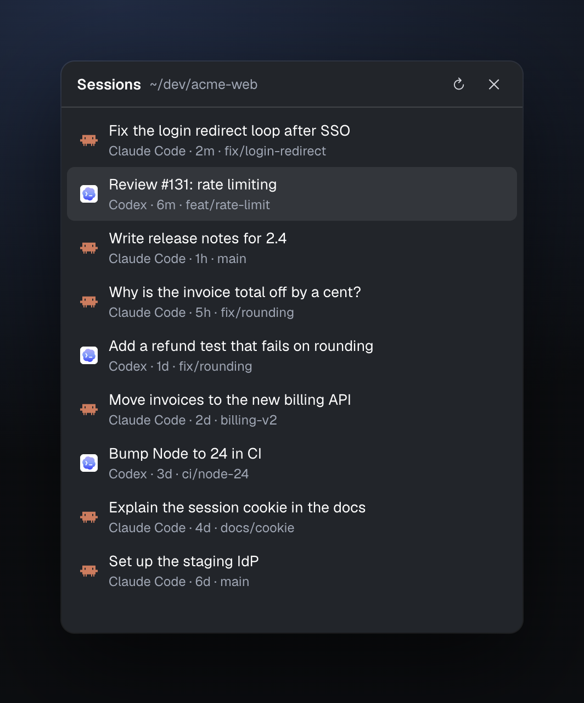

# Ray Sessions

A jump list back into earlier work: the Claude Code and Codex sessions
already started in the folder you're looking at, newest first, each one
resumable in a fresh tab with that program's own usual start command.

## What you see

- A window (420×560, `ctrl-alt-s`) or a side panel, on your theme's
  background.
- Header (42px): "Sessions", the current folder shortened to `~`-relative,
  a ↻ refresh, and, only in a window, a ✕.
- A list, newest activity first: the program's own icon (full color, or a
  single-color glyph tinted with the text color, depending on the
  program), a title (its rename, its generated title, or its last prompt —
  whichever is set — or "Untitled session"), and a meta line: the
  program's name ("Claude Code" / "Codex"), how long ago it last changed
  ("<1m", "23m", "4h", "2d"), and the git branch it was on (left out when
  that was just "HEAD").
- Up to 20 Claude Code sessions and up to 20 Codex sessions are listed —
  up to 40 rows in all, not one combined cap.
- Empty/loading states: "Focus a terminal on this computer to see its
  folder's sessions.", "Loading…", or "No Claude Code or Codex sessions in
  this folder yet." (or the script's own error line).

## How it behaves

- Clicking a row opens a new tab in the same folder, running that
  program's own start command (from the known programs list, falling back
  to just its key) with its resume flag appended — `--resume <id>` for
  Claude Code, `resume <id>` for Codex.
- The list tracks the focused terminal's folder (else the shown space's)
  and reloads when it changes, then again every 2 minutes or on ↻.
- A space on another machine shows nothing — sessions are only read on
  this computer.
- A press inside the panel gives it the accent border the focused terminal pane has, until a press elsewhere (`focus-ring.js`).

## Built from

- `mods/ray-sessions/main.js` (polling, the row, resuming),
  `list-sessions.sh` (reads the sessions), `i18n/` (English and Korean),
  `history.svg` (its icon — a clock-with-arrow glyph, tinted with the text
  color; used by the `tabs-big` mod's tab).
- `mod.json`: `place: none` (docks only where a layout or mod puts it),
  `overlay` kind `window` (420×560); `keys.json` binds `ctrl-alt-s` to
  `mod.open:ray-sessions`.
- `list-sessions.sh <folder> <limit>` is run with `/bin/sh` at the fixed
  path `mods/ray-sessions/list-sessions.sh` under the app's config folder,
  and reads, per program:
  - **Claude Code:** every `*.jsonl` file under
    `${CLAUDE_CONFIG_DIR:-$HOME/.claude}/projects/<the folder, with every
    non-alphanumeric character turned into "-">`, newest-modified first;
    a session's title is the last `customTitle` it finds in the file,
    else the last `aiTitle`, else the last `lastPrompt`; its branch is the
    last `gitBranch` found within the file's last 300,000 bytes.
  - **Codex:** the newest `state_*.sqlite` under
    `${CODEX_HOME:-$HOME/.codex}/`, queried with `sqlite3 -readonly` for
    rows in `threads` where `cwd` matches the folder exactly,
    `archived = 0`, `source` doesn't start with `{`, and `thread_source` is
    `user` or unset — which is how sub-agent and reviewer threads (whose
    `thread_source` isn't `user`) are left out; title from `name`, else
    `title`, else `first_user_message`.
- Calls: `spaces()`, `panes()`, `focused()`, `theme()`, `home()`,
  `appHome()`, `exec` (runs the script above), `run("tab.new", { folder,
  argv })`, `knownAgents()` (each program's icon, tint and start command),
  `props()`, `closeOverlay()`.

## Watch out

- The script's path is hardcoded to `mods/ray-sessions/...`: renaming the
  mod's own folder after install breaks the reads silently (`exec` just
  fails).
- Folder matching is exact: Claude Code keys sessions by a mangled copy of
  the full path, Codex by its own `cwd` column, so a session started one
  directory up or down won't show.
- Codex's query redirects its own errors to nothing, so an older Codex
  whose `threads` table doesn't have these columns just shows no Codex
  sessions, with no error.
- Claude Code's branch lookup only scans a session file's last 300KB, so a
  branch changed very early in a huge transcript may not surface.
- Resuming needs that program's entry in the known programs list; an agent
  key the script reports that isn't `claude` or `codex` is ignored outright.

## Done when

- Focusing a terminal inside a folder with earlier Claude Code or Codex
  runs lists them within a couple of seconds, newest first, with readable
  titles and ages.
- Clicking a row opens a new tab already running `claude --resume <id>`
  (or `codex resume <id>`), landing back in that conversation.
- Switching the focused terminal to a different folder reloads the list
  for it; `ctrl-alt-s` opens a 420×560 window with a working ✕.
