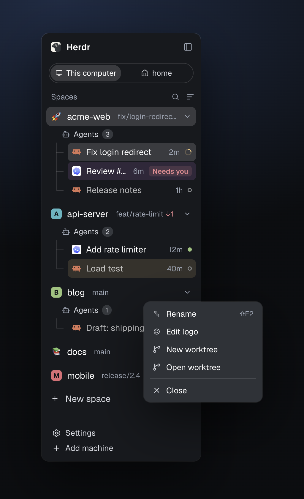

# Ray Sidebar

A sidebar of spaces with their agents nested under them, one machine's spaces at a time: a logo you can pick for each space, git's branch and ahead/behind, a fold per space, drag to reorder, and a search button that opens a matching picker (bundled with it). Narrower than 160px it collapses into a numbered rail.

## What you see

Top to bottom, inside the sidebar block:

- **Machine tabs** (34px, only once there's more than one machine): a pill-shaped strip — "This computer" first, then each other machine by name — each with a small icon (a monitor for this computer, a house for a machine named exactly "home", a server for any other), the one in view raised; a tab you're not on gets a small dot if an agent there needs you.
- **A notice row** (28px), only when the shown machine isn't connected: its state in words ("asleep", "connecting", "disconnected", "unreachable", "offline", "needs login", "error"), or, once it was rebuilt or replaced, "rebuilt ·" and a **Connect** button.
- **"Spaces" header** (34px): the label, a search button (opens the picker) and a sort button (opens a two-item menu: Priority or Tab order).
- **Each space** (32px): its logo (18px square, rounded corners) — the space's first letter on one of six colors, a typed character or emoji, a picked image, or a site's icon — the name (truncated past 140px), then only what's unusual about its git: the repo and branch when they don't already match the name, "↑N" in the theme's green for commits ahead, "↓N" in its red for behind; master/main branch names are never shown. A space with agents gets a fold chevron at the right that, folded, shows a small status mark for the most urgent one (skipped if they're all idle) plus their count, dimmed.
- A space that's a git worktree of another one shown above it sits indented underneath it (28px), with a small branch icon in place of its logo.
- **Its agents**, hanging off a vertical line under the space's logo, unless folded: an "Agents N" line (28px, a small bot icon, a count pill), then one 32px row per agent — its program's icon, its name (as its tab is named, dimmed when idle), how long it's been in its state ("<1m", "23m", "4h", "2d"), a fold for its sub-agents if any, and a status mark. Hovering a row swaps the time for a pin that opens an 8-color palette. Sub-agents are listed under their agent at 28px each, on their own tree lines, dimmed unless the one you're looking at.
- **"New space"** (30px), at the end, when the machine has no problem to show.
- Narrower than 160px, all of this becomes a **rail**: a number per space and per agent, each with just its status mark, and a "»" at the bottom to widen it back out.

## How it behaves

- An agent's status: working (an amber spinner), blocked (a red "Needs you" pill, a small "!" where space is tight), done (a filled dot), idle (a thin ring, its name dimmed).
- Clicking a space switches to it only while it has no agents yet; once it has any, clicking the row instead folds or unfolds them — you switch to it through one of its agent rows, or from the picker. The fold chevron always folds it, either way.
- Clicking an agent row focuses its pane; clicking a sub-agent row peeks at it instead.
- Dragging a space's row by its line reorders it among the others on the same machine; its agents move with it. A thin accent line shows where it will land.
- Right-click a space for **Rename**, **Edit logo**, **New worktree** / **Open worktree** / **Remove worktree**, and **Close**.
- **Edit logo**: type one character or emoji (an emoji shows as-is, anything else goes on the space's color), choose or drop an image, or type a website address and fetch its icon — any of the three takes effect at once, and a **Back to the letter** button appears once one is set.
- Hover an agent row and click its pin to tint it with one of 8 colors, or clear it.
- The search button, or `cmd-p`, opens the picker (its own recipe): spaces and tabs, drawn with the same logos and colors.
- The sort menu switches each space's own agent order between urgency (blocked, then done, then working, then idle, ties broken by how recently one changed) and plain tab order.
- English by default; every label switches to Korean when the shared language is set to Korean.

## Built from

- `mods/ray-sidebar/`: `main.js` (the sidebar itself; by `props()` it instead draws its own popups: `{ sortMenu }`, `{ colorMenu: address }`, `{ spaceMenu: id }`, `{ logo: id }`), `agents.js` (status ranks, the two `SORTS`, each agent's shown name, its sub-agent tree, its status mark), `agent-rows.js` (the agent and sub-agent row widgets), `agent-color.js` (the 8-swatch palette — `#EF4444 #F97316 #EAB308 #22C55E #14B8A6 #3B82F6 #8B5CF6 #EC4899`, tinted onto a row's background at `26` alpha, `47` when focused, `3D` on hover — kept in shared `agent.colors`), `git.js` (a `Git` class: `git --no-optional-locks -c core.fsmonitor=false status --porcelain=v2 --branch`, `git rev-parse --show-toplevel` / `--path-format=absolute --git-common-dir` to group worktrees under their repo), `machines.js` (a `Machines` class: `hc machine ls --json`, reconnecting a rebuilt machine with `hc machine rm`/`add`), `logo.js` (a space's avatar; kept in shared `space.logos`; images are copied into `~/.config/herdr-app/ray-sidebar/logos`), `logo-editor.js` (the Edit-logo dialog, 400×430), `favicon.js` (fetches a typed site's icon with `curl`), `space-menu.js` (the right-click menu, up to 200×300 tall; its worktree items open Herdr's own shipped `worktree` mod, not included here), `i18n/` (English and Korean, read through shared `ray.locale`; the Korean file carries the whole Ray Theme family's dictionary, not just the strings this mod uses).
- A space's stored color (shared `space.colors`) is one of six hues — `ansi6 #22a99a`, `ansi3 #e3814f`, `ansi4 #5b8def`, `ansi5 #8b7cf6`, `ansi2 #3fae6a`, `ansi1 #d9649a` — or a picked `#rrggbb`; a space without one gets whichever hue the fewest others currently use. Its own popups: sort menu 200×140, color palette 252×112.
- Bundles `mods/ray-picker/` (byte-identical to the standalone copy; see its own recipe), because the search button runs `run("mod.open", { name: "ray-picker" })`; `keys.json` adds the global `cmd-p` → `mod.open:ray-picker` shortcut it opens with.
- It's a block, not a window (`mod.json`: `"place": "none"`, no `overlay`): in Herdr's default layout, it replaces the `spaces` block inside the column node with id `sidebar`. It reads that node's width from `layout()` to decide the rail (under 160px), and the rail's "»" calls `run("layout.resize", { id: "sidebar", px: … })` back to `shared("sidebar.width") ?? 268`.
- Icons come from Herdr's own shipped `workspace-chrome` mod (`mods/workspace-chrome/*.svg`: chevrons, spinner, search, pin, check, x, plus, square-pen, git-branch, branch, monitor, server, and the sort menu's `clock`/`layers`) as well as this mod's own (below).
- Calls: `spaces()`, `machines()`, `panes()`, `agents()`, `terminals()`, `focused()`, `layout()`, `theme()`, `props()`, `keys()`, `window()`, `setAgentOrder()`, `run()` (`space.move`, `space.select`, `space.new`, `space.rename`, `space.close`, `pane.focus`, `terminal.peek`, `mod.open`, `layout.resize`), `openOverlay`/`closeOverlay`, `shared`/`setShared`, `watchFolder`, `appHome()`, `exec` (`git`, `curl`, `file`, `mkdir`, `cp`, `mv`, `rm`, and on macOS `sips` and `osascript`), `hc(["machine", …])`.
- Shared keys: reads and writes `space.logos`, `space.colors`, `agents.sort`, `agent.colors`; reads `ray.locale`; reads `sidebar.width` and writes `sidebar.collapsed` to `false` when unfolding from the rail. The matching write side lives in Herdr's own shipped `workspace-chrome`/`workspace-chrome-big`/`agents`/`agents-big` mods: they save `sidebar.width` and flip `sidebar.collapsed` whenever the sidebar node's own width crosses the narrow threshold, and resize it to 44px (76 on macOS) when it collapses — this mod never does either of those two things itself.
- Kept only in this device's `localStorage` (not shared): which spaces are folded, which machine tab is showing, each agent's last-changed time, and a machine reconnect in progress. Which agents are folded is kept only in memory and resets on reload.
- Art: `bot.svg` (the Agents line), `home.svg` (a machine named "home"), `smile.svg` (Edit logo), `sort.svg`.

## Watch out

- A space switches on click only until it has an agent; after that the row folds instead of switching.
- The three worktree menu items call Herdr's shipped `worktree` mod; without it installed they open nothing. They also only appear once an async `git rev-parse` confirms the folder's kind, so right after opening the menu they may briefly be missing.
- A chosen image is resized to 128px PNG only on macOS (`sips`), and only when it isn't `.svg`/`.gif`; elsewhere, or for those two formats, the original file is copied in as-is. The "Choose an image…" button itself only appears on macOS; elsewhere, dropping a file on the dialog is the only way in.
- The website-icon fetch follows redirects and reads whatever icon address the fetched page itself names, which can be a different host than the one typed (a CDN, for instance) — it isn't confined to exactly one domain, though it is capped at 15 seconds and 5MB per request, trying up to 4 candidate icon addresses before giving up.
- The "home" machine icon is a literal name match (`"home"`); any other remote machine gets the generic shipped server icon.
- The layout node must be named exactly `sidebar` and carry a `px` size, or neither the rail nor its unfold button has anything to key off.
- It's a block mod (`"place": "none"`, no `overlay`): `herdr-app check` will still load and render it once to confirm it works, but seeing it in the running app means placing it in a layout block, since it has no overlay or window to pop open on its own. It also assumes Herdr's shipped `workspace-chrome` mod's icons are present.
- Replacing only the `spaces` block leaves the default layout's separate `agents` block below it still drawing the focused space's agents a second time; a clean install likely wants that block removed or hidden too.

## Done when

- Narrowing the sidebar's node under 160px turns it into a numbered rail with colored status marks; its "»" widens it back to 268px.
- The search button and `cmd-p` both open the picker, showing the same logos and colors as the sidebar.
- Dragging a space's row past another one on the same machine reorders both it and its agents.
- Edit logo's character, image, and website-icon options each change that space's avatar in the sidebar and the picker alike.
- Hovering an agent and clicking its pin tints the row; its palette's **No color** clears it.
- Setting the shared language to Korean relabels the sidebar's text.
