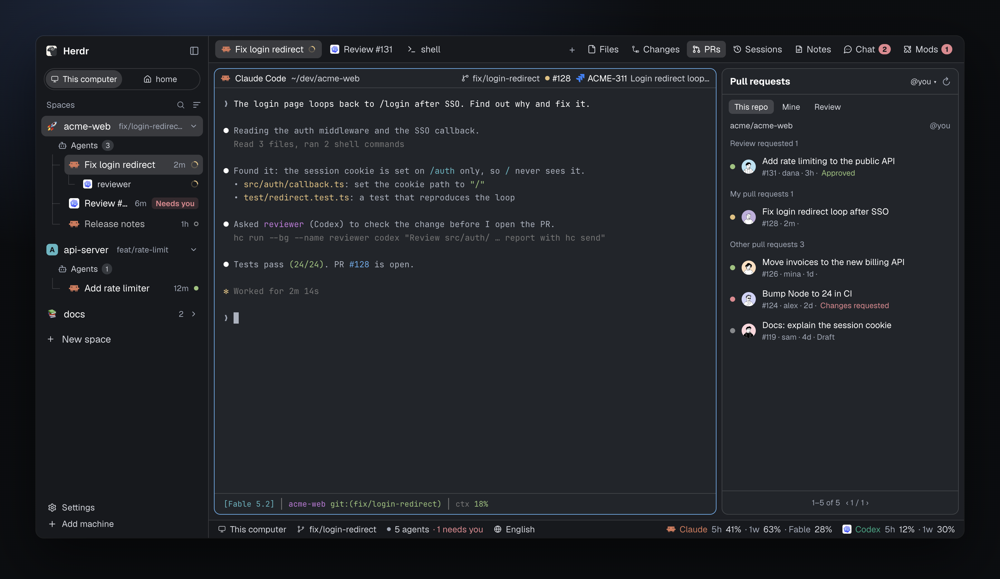

# Ray Theme

A developer's cockpit for Herdr: a sidebar of spaces with their agents nested under them, a tab bar with side panels (files, changes, pull requests, sessions, notes, agent chat, mods), a pane header that shows the branch, its pull request and Jira issue, and a status bar with your agents' usage limits.

## What you see

Left to right, top to bottom:

- **Sidebar** (268px, `chrome`): the brand row (46px, draggable window), the spaces list, and a footer (69px: Settings, Add machine).
  - Machine tabs on top when there is more than one machine ("This computer" | "home").
  - "Spaces" header with search (opens the picker) and sort.
  - Each space: its logo (first letter on its color, or an emoji, a character, an image or a website's icon you pick), name, git branch and ahead/behind, a fold chevron. Under it, on a tree line, "Agents N" and one 32px row an agent: program logo, name (as the tab is named), how long in its state, its status mark; sub-agents indented under it.
  - Right-click a space: Rename, Edit logo, worktree items, Close. Drag a space to reorder. Hover an agent and press the pin to mark it with a color.
- **Tab bar** (42px, draggable window): the space's tabs, then panel buttons on the right (Files, Changes, PRs, Sessions, Notes, Chat with an unread badge, Mods with an update badge).
- **Panes** (gap 8, padding 8, rounded 10, accent border on focus), each with a 30px header: program, folder, branch, PR number with its checks dot, Jira key and title.
- **Side panel** (368px, a stack, hidden until a button opens it).
- **Status bar** (28px): machine, branch, agents count and how many need you, the language picker (English / 한국어); on the right the usage chip (Claude 5h · 1w · Fable, Codex …).

## How it behaves

- Agent status: working (amber spinner), blocked ("Needs you" in red), done (a dot), idle (a ring, name dimmed). Pressing a row focuses that agent; a space's line folds its agents.
- `cmd-p` opens the picker (spaces and tabs, with logos); the side panel remembers which panel each space had open.
- The language picker switches every mod of the layout at once.

## Built from

- Node tree: `root` (row, `canvas`, dividers) → `sidebar` (column: `brand` = `workspace-chrome-big` {search: false}, `sidebar-list` = `ray-sidebar`, `sidebar-footer` = `workspace-chrome-big` {footer: true}) and `work` (column: `tabs` = `tabs-big`; `work-body` row: `main` = the active tab with `pane-big` headers, `panel` → `panel-body` stack of `files`, `changes` (Herdr's own), `ray-prs`, `ray-sessions`, `ray-notes`, `ray-chat`, `ray-mods`; `status-bar` row: `workspace-status-big` {palette: false}, `ray-usage` (470px), `ray-chat` {view: "watch"} (1px, records agent messages)).
- `ray-locale` holds the shared English/Korean words; every mod carries a copy in its `i18n/` (`ray-locale/sync.sh` refreshes them). `ray-picker` is a clone of Herdr's picker with logos.
- Programs: `git`, `gh` (pull requests, accounts from `~/.config/gh/hosts.yml`), `hc`, `curl`; Claude Code and Codex session files for Sessions and Chat.

## Watch out

- The layout has no look of its own: your settings.json theme and colors apply.
- A new mod folder must appear whole (`mv` it in from the same disk): the app reads its `mod.json` at once.
- Never call `cx.notify()` inside `render`; never keep a `cx`.
- PRs need `gh` logged in; usage needs the providers' own files (see Ray Usage's recipe).

## Done when

- Spaces show their agents nested, with live status; a click focuses the agent.
- Each panel button opens its panel; Chat and Mods badge their counts.
- The pane header shows the branch and its PR; the usage chip shows numbers.
