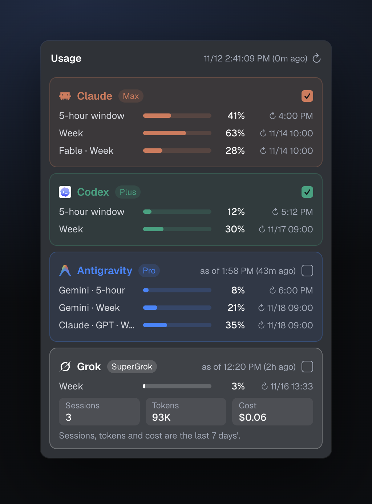

# Ray Usage

How much of your coding agents' limits you have used, in one popup: Claude (with each model's own weekly limit, such as Fable), Codex, Antigravity and Grok, each in its brand color, with when the window resets.

## What you see

- A popup (400px wide, `ctrl-alt-u`), on your theme's popover color. Header: "Usage", the time it was read ("11/10 2:26:15 PM (0m ago)"), a ↻ button.
- A card a provider (rounded 10, tinted with the brand color at 8% and a 25% border): logo 17px, the name in the brand color, a plan badge (e.g. Plus, SuperGrok), "as of …" for snapshots, and a checkbox "Show in the status bar".
- Rows: label (5-hour window, Week, a model's week), a 6px bar in the brand color, the percent (red from 80%), "resets 11/16 13:33".
- Colors: Claude `#D97757`, Codex `#10A37F`, Antigravity `#3186FF`, Grok the theme's text color.
- As a status-bar block: a chip per checked provider: logo, name, "5h 33% · 1w 64% · Fable 46%" (labels dim, numbers bright; three or more providers: logos and numbers only). Pressing it opens the popup above it.

## How it behaves

- Reads every minute; the Claude API and Grok's week every 5 minutes; ↻ reads everything now. A failed read keeps the last good one and retries in a minute.
- A window whose reset time passed shows "–".

## Built from

- `mods/ray-usage/`: `main.js` (the chip; the popup when `props().view === "panel"` or opened as an overlay), `panel.js` (cards), `sources.js` (readers), `claude-usage.sh`, `codex-live.sh`, `codex-limits.sh`, `i18n/`.
- **Claude:** `api.anthropic.com/api/oauth/usage` with Claude Code's own token from the macOS keychain (`Claude Code-credentials`, else `~/.claude/.credentials.json`), passed to `curl` on stdin; fallback: `rate_limits` from `~/.claude/.last-statusline.json` (your status line command must save its input there).
- **Codex:** `codex app-server` (JSON-RPC `account/rateLimits/read`); fallback: the newest session log's `rate_limits`.
- **Antigravity:** `quota` in `~/.gemini/antigravity-cli/.last-statusline.json` (save the status line input there), else agy-hud's `~/.cache/agy-hud/quota_cache.json`.
- **Grok:** the last `billing: fetched credits config` line in `~/.grok/logs/unified.jsonl` (weekly %), and the last 7 days' sessions, tokens and cost from `~/.grok/sessions/**/usage.json`.
- Shared: `ray.usage` (what was read), `ray.usage.chip` (checked providers).

## Watch out

- The Anthropic usage endpoint is unofficial and rate-limits (429); call it at most every few minutes.
- Grok and Antigravity values are snapshots from when those tools last ran; the card says when.
- Never print the token; keep it off the command line.

## Done when

- The popup shows a card for each tool installed here, with percentages and reset times that match each tool's own `/usage`.
- Unchecking a card removes it from the chip; ↻ updates the read time.
